

  

  
  
  
  

 


I'm a **Full-Stack Developer** focused on building maintainable web applications, RESTful APIs, and database-driven business systems.

My primary stack is **React, C#, ASP.NET Core, and SQL Server.**

 

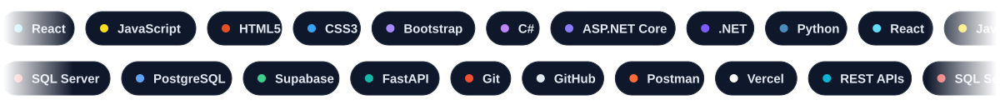

  

 


 

  <a href="https://sk-bags.vercel.app/"></a>
  <!-- Factory ERP: wrap the image in <a href="YOUR_REPO_URL"> ... </a> -->
  

  <!-- Building Materials ERP: wrap the image in <a href="YOUR_REPO_URL"> ... </a> -->
  
  <a href="https://a-2z.vercel.app/"></a>

 


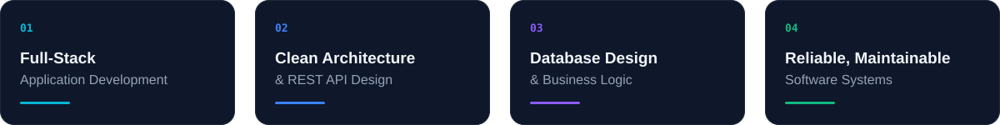

 

  
  

  

  

 

<a href="mailto:YOUR_EMAIL"></a>

  
  

  

